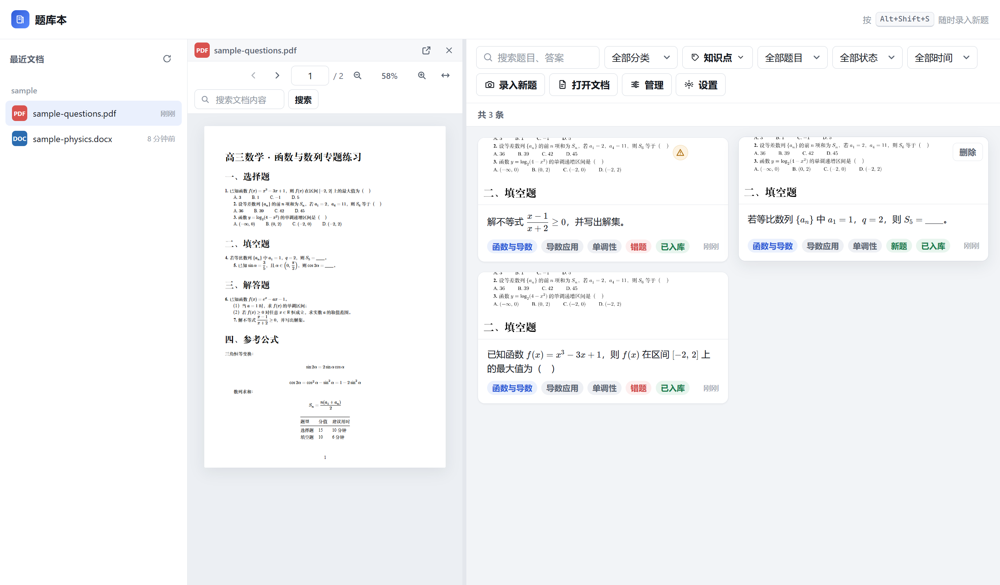

# 题库本

Windows 桌面题库工具：打开 PDF 或 Word 阅读，用全局快捷键截取题目区域，交给视觉模型识别成结构化题目，在预览面板改好之后录入本地题库，再按分类、知识点、关键词检索。

这是按 `agent-实施提示词.md` 做的最小可运行版本（demo）：阅读、截图、识别、入库、检索五步都能跑通，打包与部分边界场景未验证，详见文末「已知限制」。



## 环境

- Windows 11
- Node.js 24+
- pnpm 11.28+（`pnpm-workspace.yaml` 里的 `allowBuilds` 是 11.28 起的新字段）

## 启动

```powershell
cd D:\错题本\app
pnpm install
pnpm dev
```

`pnpm dev` 会起 Vite 开发服务器并打开主窗口。

首次启动会在 `%APPDATA%\题库本\` 下建好数据目录，三个 JSON 文件自动初始化。

## 构建

```powershell
pnpm build        # 产物在 out/
pnpm typecheck    # 主进程 + 渲染进程类型检查
```

## 自检脚本

```powershell
node scripts/e2e.mjs     # 端到端：启动 → 配置读写 → 分类增删 → 截图 → 落盘 → mock 识别 → 打开 PDF
node scripts/shot.mjs    # 重新生成 docs/screenshots 下的界面截图
python scripts/make-icon.py   # 重新生成应用图标（build/icon.ico、resources/icon.png）
```

`e2e.mjs` 会真的触发一次截图：主窗口短暂隐藏，遮罩窗口出现，脚本代替用户框选一块区域。跑完会删掉自己新建的题目、分类与知识点，并把 API Key 恢复成空。两条 Node 脚本都要先 `pnpm build`。

## 图标

图标由 `scripts/make-icon.py` 用 Pillow 画出来，源码即图形，没有外部素材依赖。

| 文件 | 用途 |
| --- | --- |
| `build/icon.ico` | 安装包、桌面快捷方式、任务栏（16–256 共 7 个尺寸） |
| `build/icon.png` | 1024×1024 母版 |
| `resources/icon.png` | 256×256，运行时窗口图标，随 `extraResources` 一起打包 |

改图标就改脚本里的坐标与配色，重跑一次，三处文件一起更新。窗口图标在 `src/main/windows.ts` 的 `appIconPath()` 里取。

## 打包

```powershell
pnpm dist
```

产物在 `release/`：

| 文件 | 说明 |
| --- | --- |
| `release/Tikuben-0.1.0-setup.exe` | NSIS 安装包，118 MB |
| `release/win-unpacked/题库本.exe` | 免安装版，双击即用，整个目录可以拷走 |
| `release/win-unpacked/` | 完整运行时目录，exe 依赖同目录的 dll 与 `resources/` |

安装包没有代码签名，首次运行 Windows SmartScreen 会拦一下，点「更多信息 → 仍要运行」。装到当前用户目录，不需要管理员权限。

数据在 `%APPDATA%\题库本\`，卸载不删。装完后再装一次，数据仍在。

## 数据目录

```
%APPDATA%\题库本\
├─ config.json              配置；apiKey 经 safeStorage 加密后存 base64
├─ data\
│  ├─ questions.json        题目
│  ├─ categories.json       分类
│  ├─ knowledge.json        知识点
│  └─ images\<uuid>.png     截图原图
```

写盘规则：

- 先写 `.tmp`，`fsync` 落盘，再 `rename` 覆盖，不直接覆盖原文件
- 所有写操作进串行队列，一次只跑一个
- 启动时解析失败，把坏文件改名成 `*.corrupt-<时间戳>.json` 备份，再初始化，不静默清空
- 卸载程序不会删这个目录

## 快捷键

默认 `Alt+Shift+S`，在设置页可以录制新组合。注册失败（被别的程序占用）时主进程会回滚到旧快捷键并提示原因。

另外：

- `Ctrl+O` 打开文档
- `Ctrl+W` 关闭当前窗口
- `Ctrl+,` 打开设置

## API 配置

设置页填三项：

| 字段 | 默认值 |
| --- | --- |
| API Base URL | `https://api.deepseek.com` |
| 模型名 | `deepseek-flash` |
| API Key | 空 |

没有 API Key 或打开「Mock 模式」时，识别走 `resources/mock/recognition.json` 里的固定夹具，随机延迟 800ms。这条路的用途是在没有网络和密钥的情况下把 UI 全流程跑通。

API Key 用 Electron 的 `safeStorage` 加密后存进 `config.json`，渲染进程只能读到 `hasApiKey: boolean`，拿不到密钥本身。

## 目录结构

```
app/
├─ electron.vite.config.ts
├─ electron-builder.yml
├─ resources/mock/recognition.json     识别夹具
├─ sample/                             测试用 PDF 与 DOCX
├─ scripts/launch.mjs                  启动包装
└─ src/
   ├─ main/                            主进程
   │  ├─ index.ts                      生命周期、菜单、自定义协议
   │  ├─ windows.ts                    主窗口 / 阅读窗口 / 设置窗口
   │  ├─ ipc.ts                        全部 ipcMain.handle
   │  ├─ config.ts                     safeStorage 存取密钥
   │  ├─ export.ts                     导出 Markdown / Word / PDF
   │  ├─ export/math.ts                LaTeX → OMML（Word 原生公式）
   │  ├─ store/                        JSON 持久化、串行队列、内存检索
   │  ├─ capture/                      快捷键、抓屏裁剪、遮罩窗口
   │  └─ vision/                       提示词、接口调用、解析、mock
   ├─ preload/index.ts                 contextBridge 白名单
   ├─ shared/types.ts                  主进程与渲染进程共用的类型与 IPC 通道
   └─ renderer/
      ├─ index.html / viewer.html / overlay.html / settings.html
      └─ src/{main,viewer,overlay,settings,shared}/
```

## 已实现

- 主窗口三栏：左列文件、中间阅读器、右侧题库；两条分隔条都能拖，双击复位，宽度记在 localStorage
- 左列文件栏可以整个收起（顶部面板图标），收起后阅读器随即变宽
- 阅读器并排双栏：两栏之间可拖，双击恢复均分；栏宽变化时 PDF 自动按宽度重排
- PDF 阅读器基于 pdfjs 官方 `PDFViewer` 组件：文字可选可复制、页内搜索带高亮与跳转、内部链接可点、单页翻页与连续滚动两种模式
- DOCX 阅读器：docx-preview 渲染进 iframe，样式与宿主隔离
- 题库视图（主窗口内切换）：批量查看与勾选、按分类筛选；每道题可展开解析，公式实时渲染
- 批量导出 Markdown / Word / PDF；Word 里的公式是 OMML 原生公式，可在 Word 里直接编辑
- 筛选：关键词（200ms 防抖）、分类、知识点多选（任一 / 全部）、错题新题、状态、时间范围
- 卡片流：缩略图、题干摘要与关键词高亮、分类与知识点标签、状态（待识别 / 识别中 / 待确认 / 已入库）
- 编辑抽屉：左图右表单，题干与解析都是 Markdown + KaTeX 实时预览，选项增删改，分类与知识点新建
- 同一道题可以挂多张截图：抽屉里横向缩略图切换、单张删除、「+ 追加截图」再截一张；截图时抽屉先滑出视口，不挡画面
- 截图：全局快捷键 → 抓光标所在屏（**主窗口保持打开**，所以能截窗口内阅读器里的题目）→ 全屏遮罩拖框 → 松开后可拖边角调整选区 → Enter 或双击确认 → 按图片实际尺寸反算裁剪 → 长边压到 1600 → 落盘
- 识别：真实接口（`response_format: json_object`，空返回重试一次，围栏兜底）与 mock 两条路；范围限定高中数学；题目和解答过程同时出现时分别识别进 `answer` 与 `analysis`，解析按 Markdown 排版但要求不改写原文
- 一图多题：第一条回填原草稿，其余各建一条草稿，共用同一张截图
- 设置页：Base URL、模型、Key、快捷键录制、mock 开关、数据目录

## 已知限制

- **范围只到高中数学**：识别提示词限定在高中数学，截到其他学科或大学数学的内容会返回空数组并在 warnings 里说明，不会硬识别。
- **安装流程**：安装包已生成，免安装版启动、界面、IPC 都实测过；但没走「安装 → 卸载 → 重装」完整流程，桌面快捷方式与卸载后数据保留未实测。
- **阅读 Word 里的公式**：docx-preview 对 OMML 支持不完整，这是「打开 .docx 阅读」这条路的短板。渲染后如果空段落比例超过 5%，阅读窗口顶部会显示「公式可能显示不全，以原图为准」。
- **导出 Word 的公式**：转换链路验证到 XML 层面（OMML 结构正确、无占位符与 LaTeX 残留、公式在段落层级），但没有在 Word 里打开确认分式对齐、行高与字号匹配。
- **导出 PDF 的公式**：仍是 Unicode 近似写法（`\frac{a}{b}` 显示为 `(a)/(b)`），不是排版后的公式。要精确排版请导出 Word 或 Markdown。
- **截图坐标**：只在单屏、100% 缩放下实测。换算用的是「图片实际尺寸 ÷ CSS 视口尺寸」，没有直接用 `display.scaleFactor`；多屏与 125% / 150% 缩放没有在真实缩放屏上验证。
- **全局快捷键**：注册失败会回滚并提示，但「注册成功」这一点没有单独断言。截图链路是通过 `api.capture.start()` 触发的，绕过了快捷键本身。
- **识别质量**：真实接口在样例数学题上跑通，公式与选项识别正确；没有做过系统的准确率评测，效果取决于截图清晰度与题目排版。
- **搜索**：关键词是大小写不敏感的子串包含匹配，没有分词，也不搜分类名与知识点名。
- **检索结果上限**：主窗口一次拉 200 条，没有分页。
- **.doc 老格式**不支持，选择文件时已被过滤。
- 没有做题目去重、OCR 兜底。

## 第三方依赖的许可

除常规依赖外，导出链路引入了 `mathml2omml`（MathML → OMML），许可为 **LGPL-3.0**。它被打进主进程 bundle。自用没问题；如果要对外分发这个应用，需要提供替换该库的方式，或换成别的实现。

## 开发注意事项

`ELECTRON_RUN_AS_NODE` 环境变量会让 Electron 退化成纯 Node 进程，主进程在 `protocol.registerSchemesAsPrivileged` 处直接崩掉，报 `Cannot read properties of undefined (reading 'registerSchemesAsPrivileged')`。`scripts/launch.mjs` 会在启动子进程前清掉这个变量，`pnpm dev` / `pnpm build` 都走它。直接用 `electron .` 启动时要自己确认这个变量不存在。
